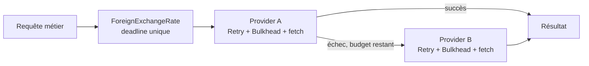
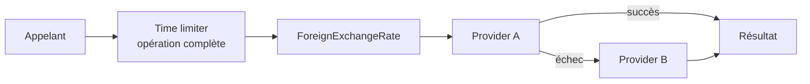

La frontière pertinente est `ForeignExchangeRate.get` : elle couvre le cache, l’appel à A et le fallback vers B. Le timeout dans `Retry` est, lui, par tentative. Son signal peut demander l’arrêt d’un appel actif, mais la file d’attente du `Bulkhead` ne l’observe pas. Un timeout global doit donc avoir une portée plus large et être propagé dans toute la chaîne.

**Option 1 — Deadline portée par le cas d’usage (recommandée)**

Le cas d’usage démarre une seule échéance; A, ses retries et le fallback B consomment le même budget restant. Les limites par tentative restent en place, mais aucune nouvelle attente ou tentative ne devrait dépasser la deadline.

Cette option correspond le mieux à une durée maximale **métier** et fonctionne aussi pour des appelants non HTTP. Elle suppose de propager l’annulation aux retries, aux attentes Bulkhead et aux appels réseau.

**Option 2 — Budget créé à l’entrée HTTP**

`Webserver` démarre le budget et le transmet au cas d’usage. Il peut aussi lier l’annulation à la fin ou à la déconnexion de la requête HTTP.

C’est adapté si le contrat principal est un délai de réponse HTTP. Comme l’option 1, cela peut couvrir A puis B si le budget est propagé; en revanche, cela ne protège pas les usages non HTTP à moins qu’ils définissent leur propre budget.

**Option 3 — Time limiter autour du cas d’usage**

Un composant transversal enveloppe l’opération complète, sans faire porter la politique de timeout directement par le code métier.

La portée est semblable à l’option 1; la différence est surtout l’endroit où la politique est organisée. Il faut que le time limiter propage réellement une annulation à la chaîne. Une simple course entre la promesse et un timer ferait cesser l’attente de l’appelant, mais ne garantirait pas l’arrêt du travail en arrière-plan.

**En bref :** je privilégierais l’option 1 pour une deadline réutilisable par tous les appelants métier. L’option 2 convient si cette limite appartient au contrat HTTP; l’option 3 si vous souhaitez une politique transversale. Dans tous les cas, la `RequestCoalescer` partage une promesse entre appels de même clé : il faudra décider si la deadline s’applique à cette opération partagée ou si chaque appelant peut cesser d’attendre indépendamment.